# Mortalidad en Colombia 2019 — Aplicación web interactiva con Dash

**Maestría en Inteligencia Artificial · Aplicaciones I · Universidad de La Salle**
Actividad 4 : Aplicación web interactiva para el análisis de mortalidad en Colombia.

**Integrantes:**
- Nelson Javier Garzón Gámez

**Aplicación desplegada:** _[https://mortalidad-colombia-2019-44ys.onrender.com](https://mortalidad-colombia-2019-44ys.onrender.com)_
**Repositorio:** _[https://github.com/njgarzon/mortalidad-colombia-2019](https://github.com/njgarzon/mortalidad-colombia-2019)_

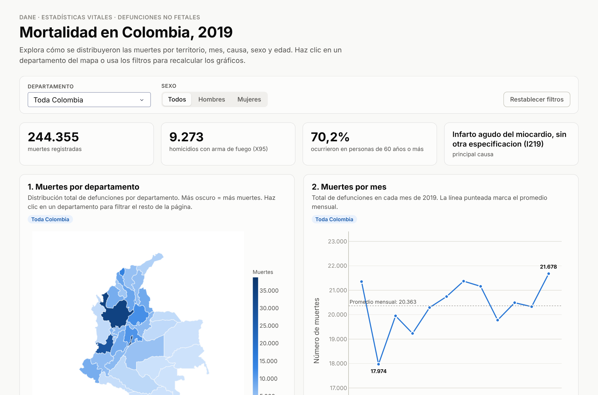

---

## 1. Introducción del proyecto

Esta aplicación web permite explorar de forma visual e interactiva las **244.355 defunciones no fetales registradas en Colombia durante 2019**, a partir de los microdatos de Estadísticas Vitales (EEVV) del DANE. Está construida en Python con **Plotly** y **Dash**, y se despliega en **Render** como plataforma como servicio (PaaS), de modo que cualquier persona puede consultarla desde el navegador sin instalar nada.

La aplicación integra siete visualizaciones (mapa, línea, barras, circular, tabla, barras apiladas e histograma), cuatro indicadores resumen y filtros globales por **departamento** y **sexo**. Al hacer clic en un departamento del mapa, el resto de la página se recalcula para ese territorio.

## 2. Objetivo

Transformar los datos de mortalidad de 2019 en representaciones visuales comprensibles que permitan identificar:

- **Dónde** se concentran las muertes (departamentos y municipios).
- **Cuándo** ocurren (variación mensual a lo largo del año).
- **De qué** muere la población (principales causas según la CIE-10).
- **Quiénes** mueren (diferencias por sexo y por etapa del ciclo de vida).
- Qué municipios presentan **mayor violencia homicida con arma de fuego** y cuáles registran **menor mortalidad**.

## 3. Estructura del proyecto

```
mortalidad-colombia-2019/
├── app.py                       # Aplicación Dash: carga de datos, gráficos, layout y callbacks
├── requirements.txt             # Librerías y versiones exactas
├── Procfile                     # Comando de arranque (gunicorn) para PaaS
├── render.yaml                  # Configuración de Render (Blueprint)
├── .python-version              # Versión de Python usada por Render (3.13)
├── assets/
│   └── style.css                # Estilos de la página (Dash carga /assets automáticamente)
├── data/
│   ├── raw/                     # Archivos originales entregados en la actividad
│   │   ├── NoFetal2019.xlsx         # Microdatos de defunciones no fetales 2019 (DANE)
│   │   ├── CodigosDeMuerte.xlsx     # Catálogo CIE-10 (códigos a 3 y 4 caracteres)
│   │   └── Divipola.xlsx            # División Político-Administrativa de Colombia
│   ├── processed/               # Datos limpios y unidos, generados por scripts/preparar_datos.py
│   │   ├── defunciones_2019.csv.gz
│   │   ├── codigos_muerte.csv
│   │   └── divipola.csv
│   └── geo/
│       └── departamentos_colombia.geojson  # Polígonos de departamentos (MGN 2018, DANE)
├── scripts/
│   └── preparar_datos.py        # Limpieza y unión de los Excel → data/processed
└── docs/
    └── img/                     # Capturas de pantalla usadas en este README
```

**¿Por qué una carpeta `processed`?** El Excel de defunciones pesa 19 MB y tarda varios segundos en leerse. El script `preparar_datos.py` lo convierte una sola vez en un CSV comprimido de ~2 MB con solo las columnas necesarias y ya unido con DIVIPOLA. Así la aplicación arranca rápido y usa poca memoria (~180 MB), lo que permite correrla en el plan gratuito de Render. Si la carpeta `processed` no existe, `app.py` la regenera automáticamente a partir de los Excel.

### Tratamiento de los datos

| Paso | Detalle |
|---|---|
| Unión con DIVIPOLA | Por `COD_DANE` (5 dígitos). Los 244.355 registros encontraron su municipio y departamento. |
| Unión con CIE-10 | `COD_MUERTE` aparece a 4 caracteres (p. ej. `I219`) y a 3 (p. ej. `C61`). Se construyó un diccionario con ambos niveles; el 100 % de los códigos tiene descripción. |
| Sexo | `1 = Hombre`, `2 = Mujer`, `3 = Indeterminado` (93 casos). |
| Ciclo de vida | `GRUPO_EDAD1` se agrupa según la tabla de referencia de la actividad (0–4 neonatal, 5–6 infantil, …, 29 edad desconocida). |
| Homicidios X95 | Registros cuyo `COD_MUERTE` empieza por `X95` (X950–X959): *agresión con disparo de otras armas de fuego, y las no especificadas*. |
| Capitales | Municipios con código terminado en `001`, excepto `25001` (Agua de Dios); la capital de Cundinamarca es Bogotá (`11001`). |

## 4. Requisitos

- Python **3.11 o superior** (probado con 3.13)
- Librerías (ver `requirements.txt`):

| Librería | Versión | Uso |
|---|---|---|
| dash | 4.5.0 | Framework de la aplicación web, componentes y callbacks |
| plotly | 7.1.0 | Gráficos interactivos |
| pandas | 3.0.5 | Limpieza, unión y agregación de datos |
| openpyxl | 3.1.5 | Lectura de los archivos `.xlsx` originales |
| gunicorn | 26.2.0 | Servidor WSGI de producción en Render |

## 5. Software

- **Python** — lenguaje de programación.
- **Dash** (Plotly) — framework para aplicaciones web analíticas.
- **Plotly** — librería de visualización interactiva (`Choroplethmap`, `Scatter`, `Bar`, `Pie`).
- **Dash DataTable** — tabla de causas de muerte.
- **pandas / openpyxl** — procesamiento de datos.
- **Gunicorn** — servidor web de producción.
- **Git y GitHub** — control de versiones y repositorio.
- **Render** — plataforma como servicio (PaaS) para el despliegue.
- **Visual Studio Code** — editor de código.

## 6. Instalación (ejecución local)

```bash
# 1. Clonar el repositorio
git clone https://github.com/USUARIO/mortalidad-colombia-2019.git
cd mortalidad-colombia-2019

# 2. Crear y activar un entorno virtual
python -m venv .venv
# Windows:
.venv\Scripts\activate
# macOS / Linux:
source .venv/bin/activate

# 3. Instalar dependencias
pip install -r requirements.txt

# 4. (Opcional) Regenerar los datos procesados a partir de los Excel
python scripts/preparar_datos.py

# 5. Ejecutar la aplicación
python app.py
```

Abrir en el navegador: <http://127.0.0.1:8050>

## 7. Despliegue en Render

1. **Subir el proyecto a GitHub** (repositorio público) con todos los archivos de esta estructura, incluida la carpeta `data/`.
2. Crear una cuenta en <https://render.com> e iniciar sesión con GitHub.
3. En el panel, elegir **New → Web Service** y seleccionar el repositorio `mortalidad-colombia-2019`.
4. Configurar el servicio:
   - **Language / Runtime:** Python 3
   - **Branch:** `main`
   - **Build Command:** `pip install -r requirements.txt`
   - **Start Command:** `gunicorn app:server --workers 1 --timeout 120`
   - **Instance Type:** Free
5. Pulsar **Deploy Web Service** y esperar a que el log muestre `Your service is live`.
6. Copiar la URL pública (`https://<nombre>.onrender.com`) y verificarla en una ventana de incógnito.

> Alternativa: como el repositorio incluye `render.yaml`, también se puede usar **New → Blueprint**, y Render toma la configuración automáticamente.
>
> Clave técnica: Dash corre sobre Flask; en `app.py` se expone `server = app.server`, que es el objeto que Gunicorn sirve con `app:server`.
>
> En el plan gratuito el servicio "se duerme" tras 15 minutos sin visitas; la primera carga posterior puede tardar entre 30 y 60 segundos.

---

## 8. Visualizaciones y explicación de los resultados

La página incluye cuatro indicadores resumen que se recalculan con los filtros: total de muertes (**244.355**), homicidios con arma de fuego X95 (**9.273**), proporción de muertes en personas de 60 años o más (**70,2 %**) y la principal causa de muerte (**I219 – Infarto agudo del miocardio**).

### 8.1 Mapa — Distribución total de muertes por departamento

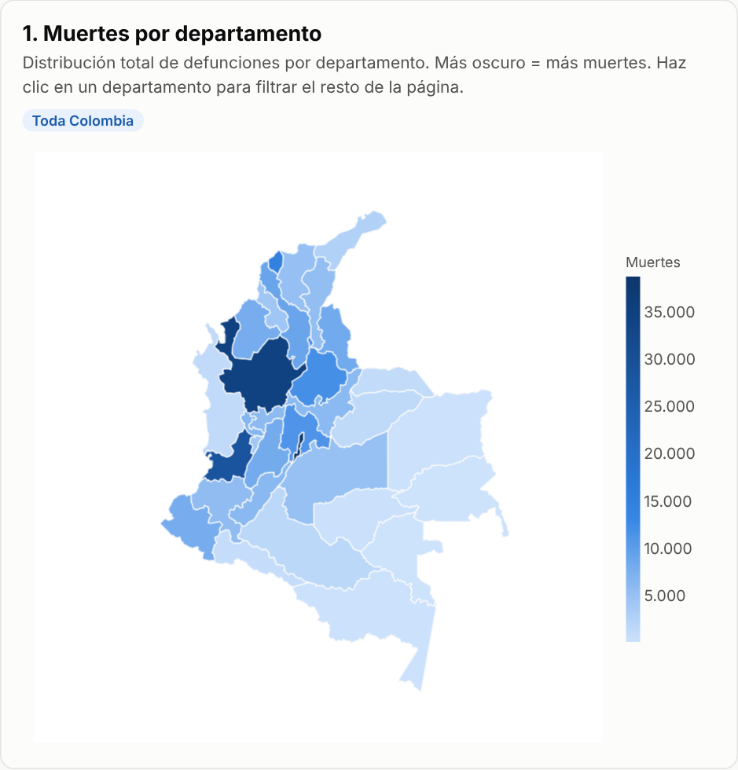

Mapa coroplético en escala de azules: a mayor número de muertes, más oscuro. Al pasar el cursor se ve el total y el porcentaje nacional; al hacer clic, toda la página se filtra por ese departamento.

**Hallazgos:**
- **Bogotá D.C. (38.760), Antioquia (34.473) y Valle del Cauca (28.443)** concentran el **41,6 %** de las muertes del país. Les siguen Atlántico (14.804) y Santander (11.894).
- Los departamentos de la Orinoquía y la Amazonía —**Vaupés (87), Guainía (115), Vichada (188), Amazonas (190)**— y San Andrés (239) registran menos defunciones.
- El patrón sigue de cerca la **distribución de la población**: el mapa muestra volumen absoluto, no riesgo. Para comparar riesgo entre territorios haría falta una tasa por 100.000 habitantes con las proyecciones de población del DANE.

### 8.2 Gráfico de líneas — Total de muertes por mes

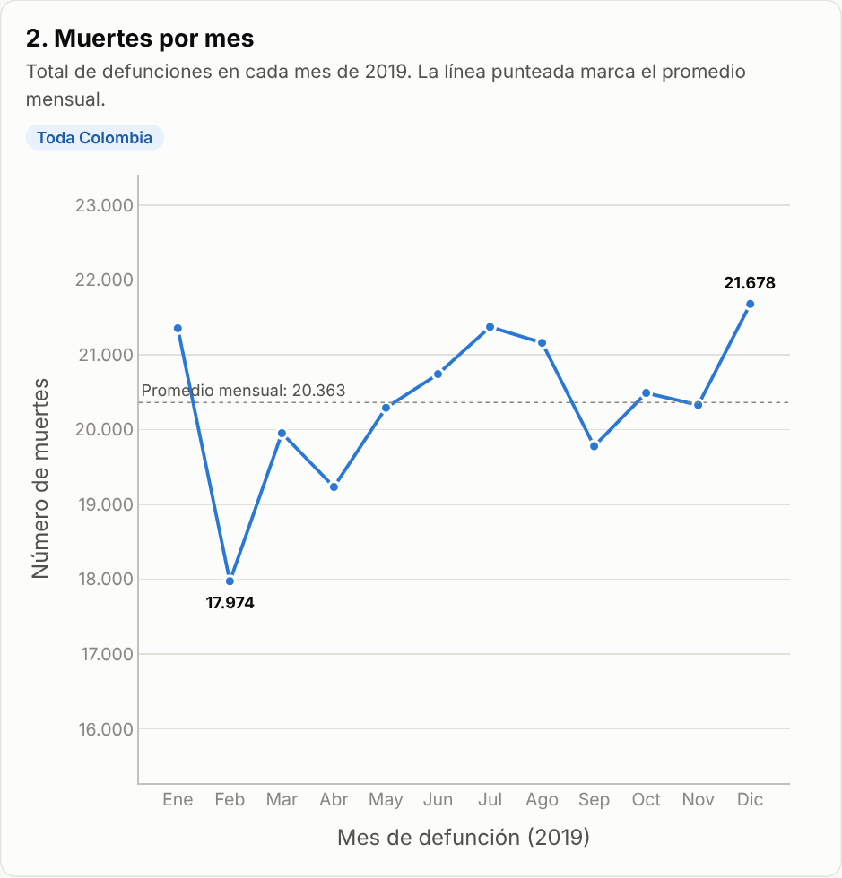

**Hallazgos:**
- El promedio fue de **20.363 muertes por mes**.
- **Febrero** tiene el mínimo (**17.974**), en buena parte porque es el mes más corto (28 días).
- **Diciembre** marca el máximo (**21.678**), seguido de julio (21.372) y enero (21.354).
- La variación es moderada: fuera de febrero, todos los meses están entre ~19.200 y ~21.700, lo que indica una mortalidad relativamente estable durante el año, con leves repuntes a mitad y final de año.

### 8.3 Gráfico de barras — Las 5 ciudades más violentas (homicidios X95)

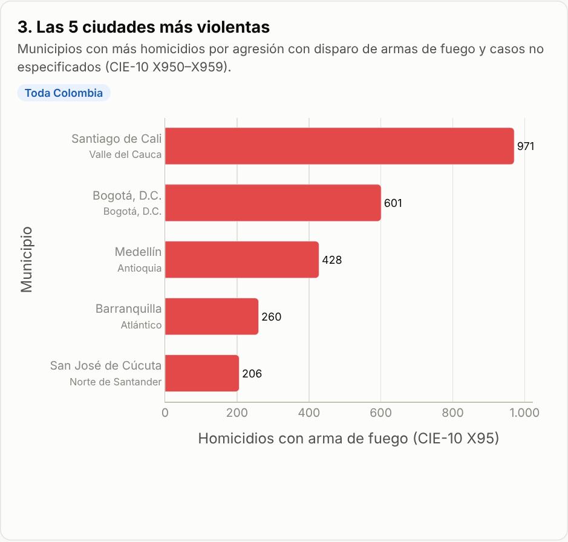

Se consideran los homicidios con código CIE-10 **X95** (*agresión con disparo de otras armas de fuego, y las no especificadas*, X950–X959).

**Hallazgos:**
- **Santiago de Cali** encabeza la lista con **971** homicidios por arma de fuego, muy por encima de **Bogotá (601)**, aunque Bogotá tiene casi el triple de población.
- Completan el top 5 **Medellín (428), Barranquilla (260) y San José de Cúcuta (206)**. Muy cerca queda San Andrés de Tumaco (192).
- Estas cinco ciudades suman el **26,6 %** de los 9.273 homicidios X95 del país.
- El **93,5 %** de las víctimas de X95 fueron hombres, y la mayoría estaba en la juventud (20–29 años) y la adultez temprana (30–44 años).
- El código **X954** (disparo en *calles y carreteras*) aparece por sí solo dentro de las 10 principales causas de muerte del país.

### 8.4 Gráfico circular — Las 10 ciudades con menor índice de mortalidad

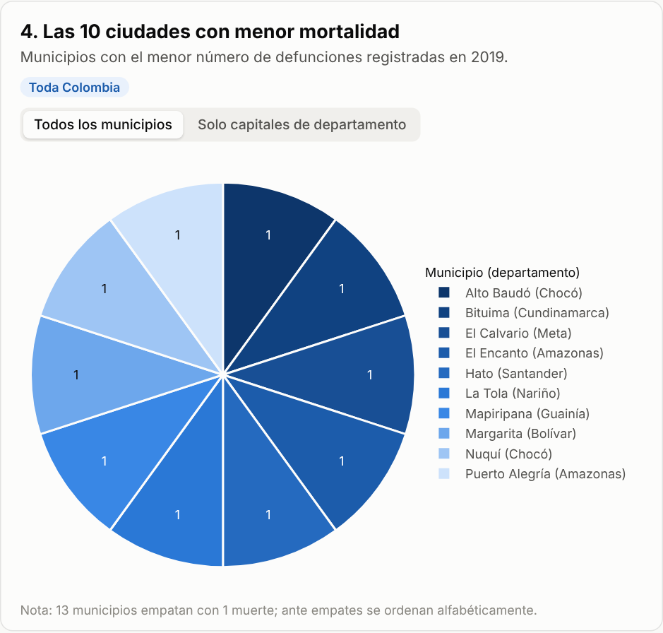

Como los archivos de la actividad no incluyen población, el "índice" se mide como **número de defunciones registradas** por municipio.

**Hallazgos:**
- **13 municipios empatan con una sola muerte** registrada en 2019 (entre ellos Alto Baudó, Bituima, El Calvario, El Encanto, Hato, La Tola, Mapiripana, Margarita, Nuquí y Puerto Alegría). Ante el empate, se ordenan alfabéticamente y el gráfico muestra porciones iguales.
- Son municipios pequeños o rurales, muchos en Chocó, Amazonas y la Orinoquía. Además, **13 municipios de DIVIPOLA no registran ninguna defunción** en 2019.
- Un número muy bajo también puede reflejar **subregistro** o que las personas fallecen en otro municipio (por ejemplo, en la cabecera donde hay hospital), ya que el dato corresponde al lugar de la defunción.

Para una comparación más informativa, el gráfico tiene la opción **"Solo capitales de departamento"**:

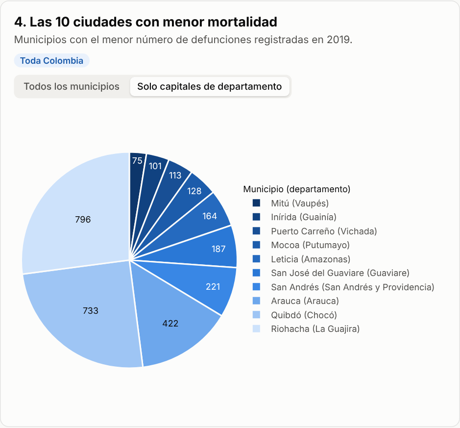

Entre las capitales, las de menor número de muertes son **Mitú (75), Inírida (101), Puerto Carreño (113), Mocoa (128) y Leticia (164)**, todas en la Amazonía y la Orinoquía.

### 8.5 Tabla — Las 10 principales causas de muerte

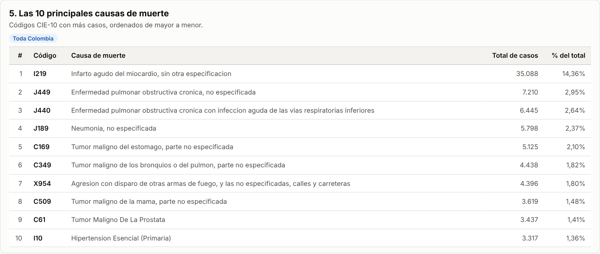

| # | Código | Causa | Casos | % |
|---|---|---|---:|---:|
| 1 | I219 | Infarto agudo del miocardio, sin otra especificación | 35.088 | 14,36 % |
| 2 | J449 | Enfermedad pulmonar obstructiva crónica, no especificada | 7.210 | 2,95 % |
| 3 | J440 | EPOC con infección aguda de las vías respiratorias inferiores | 6.445 | 2,64 % |
| 4 | J189 | Neumonía, no especificada | 5.798 | 2,37 % |
| 5 | C169 | Tumor maligno del estómago, parte no especificada | 5.125 | 2,10 % |
| 6 | C349 | Tumor maligno de los bronquios o del pulmón | 4.438 | 1,82 % |
| 7 | X954 | Agresión con disparo de arma de fuego, calles y carreteras | 4.396 | 1,80 % |
| 8 | C509 | Tumor maligno de la mama, parte no especificada | 3.619 | 1,48 % |
| 9 | C61 | Tumor maligno de la próstata | 3.437 | 1,41 % |
| 10 | I10 | Hipertensión esencial (primaria) | 3.317 | 1,36 % |

**Hallazgos:**
- El **infarto agudo del miocardio** es, por mucho, la primera causa: **1 de cada 7 muertes** (14,4 %), casi cinco veces más que la segunda.
- Dominan las **enfermedades crónicas no transmisibles**: cardiovasculares (I219, I10), respiratorias crónicas (EPOC: J449 y J440 suman 13.655 casos) y cánceres (estómago, pulmón, mama y próstata).
- La única causa externa en el top 10 es el **homicidio por arma de fuego en vía pública (X954)**, en el séptimo lugar, por encima de los cánceres de mama y próstata.

### 8.6 Gráfico de barras apiladas — Muertes por sexo en cada departamento

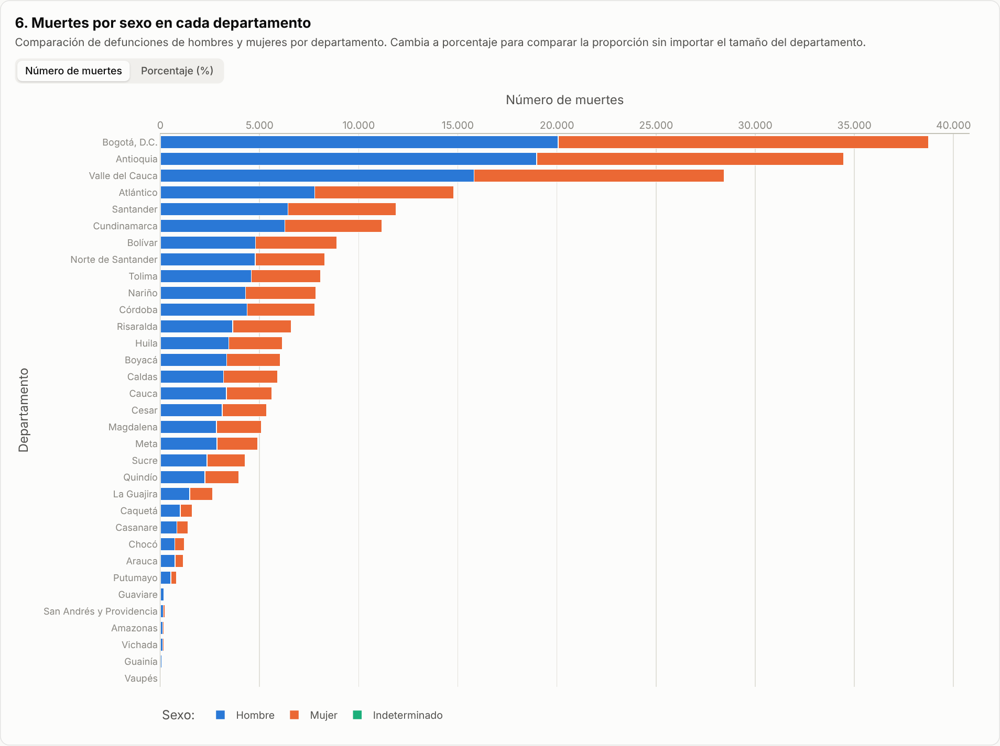

El selector permite ver números absolutos o porcentajes. La vista en porcentaje facilita comparar departamentos de tamaños muy distintos:

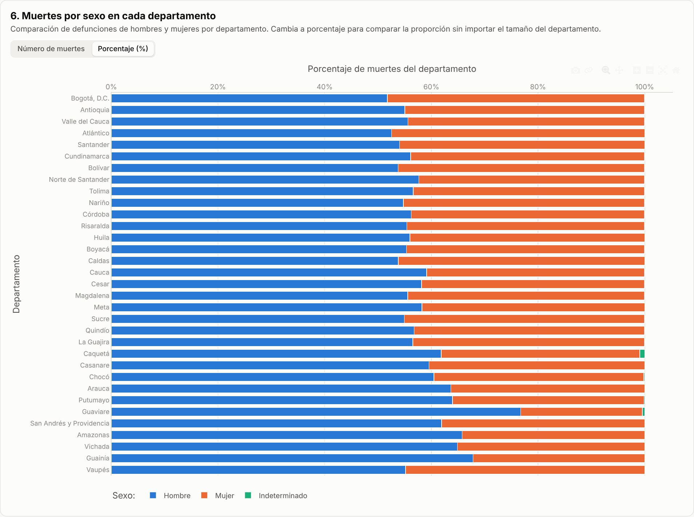

**Hallazgos:**
- A nivel nacional murieron más **hombres (134.573; 55,1 %)** que **mujeres (109.689; 44,9 %)**. Solo 93 casos tienen sexo indeterminado.
- En **todos los departamentos** la mortalidad masculina supera a la femenina.
- La brecha es menor en los departamentos más urbanos, como **Bogotá (51,7 % hombres)** y Atlántico (52,5 %).
- La brecha es mayor en la periferia: **Guaviare (76,8 %)**, Guainía (67,8 %), Amazonas (65,8 %) y Vichada (64,9 %), lo que sugiere un mayor peso de muertes violentas y accidentales en hombres en esas regiones.

### 8.7 Histograma — Distribución de muertes por ciclo de vida (GRUPO_EDAD1)

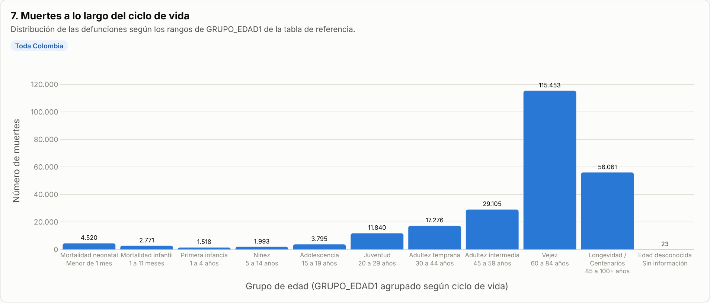

**Hallazgos:**
- La mortalidad se concentra en la **vejez (60–84 años: 115.453; 47,2 %)** y la **longevidad (85+ años: 56.061; 22,9 %)**: 7 de cada 10 muertes ocurren después de los 60 años.
- Le sigue la **adultez intermedia (45–59 años: 29.105; 11,9 %)**.
- La **mortalidad neonatal (4.520)** supera a la de la primera infancia y la niñez juntas, y es un indicador importante de la calidad de la atención materno-perinatal.
- En **juventud (20–29 años)** hay 11.840 muertes y en **adolescencia** 3.795. En estas edades el 78,5 % de quienes mueren son hombres, lo que coincide con el peso de los homicidios.
- Solo **23** registros tienen edad desconocida, lo que habla bien de la calidad del dato.

### 8.8 Interactividad

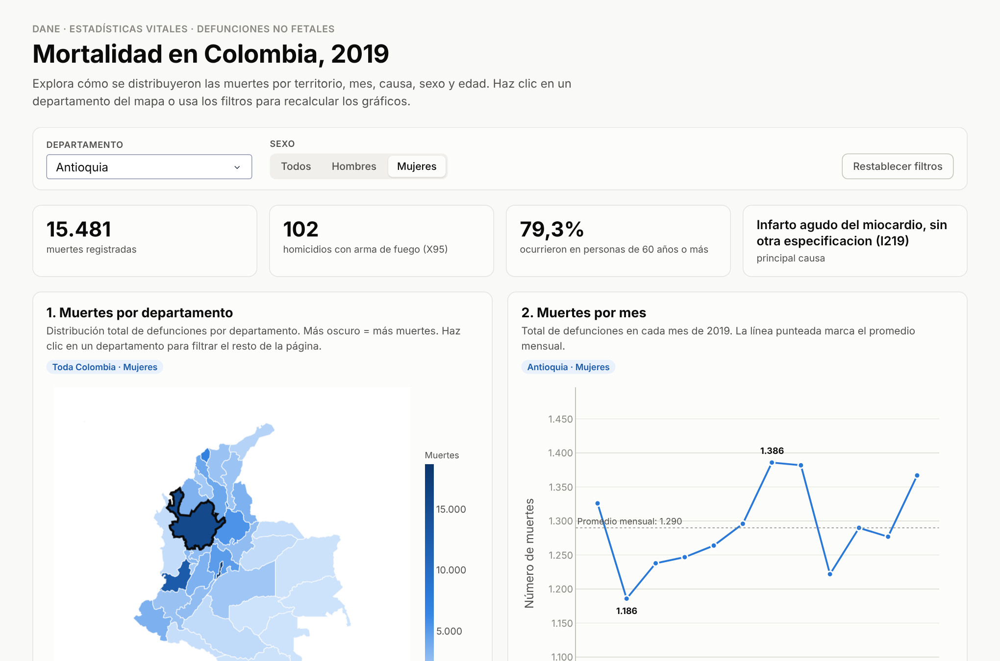

- **Filtro por departamento** (lista desplegable o clic en el mapa): recalcula los indicadores, la línea mensual, el top de ciudades violentas, el gráfico circular, la tabla de causas y el histograma.
- **Filtro por sexo:** se aplica a todos los gráficos; en las barras apiladas resalta el sexo elegido.
- **Tooltips** en todos los gráficos con el valor exacto y el porcentaje.
- **Botón "Restablecer filtros"** para volver a la vista nacional.

## 9. Conclusiones

- La mortalidad en Colombia en 2019 estuvo dominada por **enfermedades crónicas en personas mayores**, con el infarto agudo del miocardio como primera causa.
- La **violencia con armas de fuego** sigue siendo un problema de salud pública: ocupa un lugar dentro de las diez primeras causas, afecta sobre todo a **hombres jóvenes** y se concentra en ciudades como **Cali**.
- El **volumen** de muertes sigue a la población (Bogotá, Antioquia, Valle). Una siguiente versión podría incorporar las proyecciones de población del DANE para calcular **tasas de mortalidad** y comparar el riesgo real entre territorios.

## Fuentes

- DANE. *Estadísticas Vitales (EEVV) 2019 — Defunciones no fetales.* <https://www.dane.gov.co> (sección Estadísticas Vitales)
- DANE. *Codificación de la División Político-Administrativa de Colombia (DIVIPOLA).*
- Ministerio de Salud y Protección Social. *Clasificación Internacional de Enfermedades CIE-10.*
- DANE. *Marco Geoestadístico Nacional 2018* (geometrías departamentales), simplificadas en [caticoa3/colombia_mapa](https://github.com/caticoa3/colombia_mapa).
- Plotly. *Dash Documentation.* <https://dash.plotly.com>
- Render. *Deploy a Dash app.* <https://render.com/docs>
